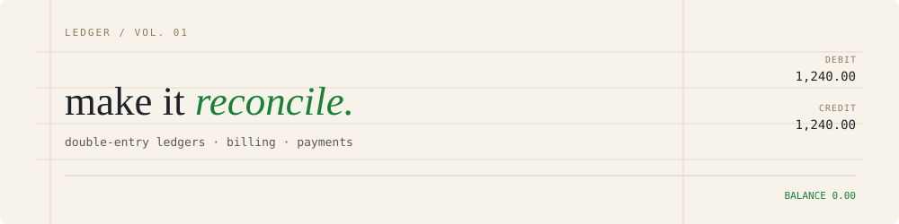

<picture>
  <source media="(prefers-color-scheme: dark)" srcset="assets/hero-dark.svg">
  
</picture>

# Daniel Rangel

Backend engineer in Colombia. I work on the part of money systems that never
makes it to the landing page: ledgers that balance, invoices that add up, and
payments that don't get charged twice.

Java and Spring Boot are home. PostgreSQL is where I trust the rules to live.
I write React when a project needs a face.

**The shape of most of my work**

<picture>
  <source media="(prefers-color-scheme: dark)" srcset="assets/flow-dark.svg">
  
</picture>

*Rules close to the data, events that survive a crash.*

I've built [Ledgerline](https://github.com/Dan1el71/ledgerline), a digital bank
on a double-entry ledger; [Billforge](https://github.com/Dan1el71/billforge),
multi-tenant billing for SaaS; and [Shopstack](https://github.com/Dan1el71/shopstack),
an e-commerce stack end to end. Each repo has the architecture, the trade-offs,
and the known limitations.

[rangelm.site](https://rangelm.site) · [Email](mailto:ddrmhk1@gmail.com) · [GitHub](https://github.com/Dan1el71)
