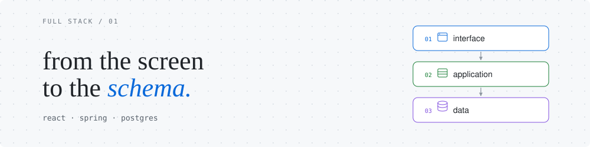

<picture>
  <source media="(prefers-color-scheme: dark)" srcset="assets/fullstack-dark.svg">
  
</picture>

# Daniel Rangel

Full-stack developer in Colombia. I like building the whole path: interfaces
that feel simple, APIs that hold up, and data that stays consistent.

React and Next.js on the front, Java and Spring Boot on the back, PostgreSQL
where the rules live. I care more about clear boundaries than about adding
another framework.

## Toolbox

<h3 align="center">Languages</h3>

  
  
  
  

<h3 align="center">Frontend</h3>

  
  
  
  

<h3 align="center">Backend</h3>

  
  
  
  
  

<h3 align="center">Data and messaging</h3>

  
  
  
  

<h3 align="center">Cloud and infrastructure</h3>

  
  
  
  
  

<h3 align="center">Testing</h3>

  
  

[rangelm.site](https://rangelm.site) · [Email](mailto:ddrmhk1@gmail.com) · [GitHub](https://github.com/Dan1el71)
